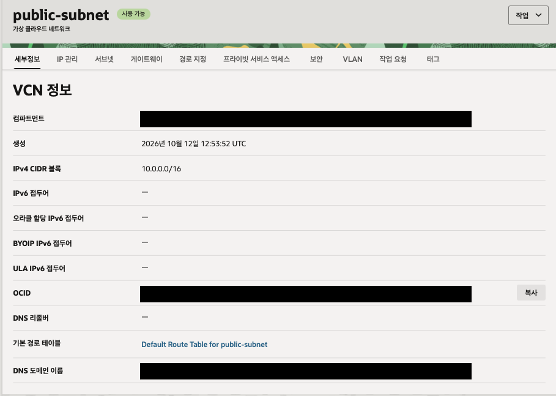
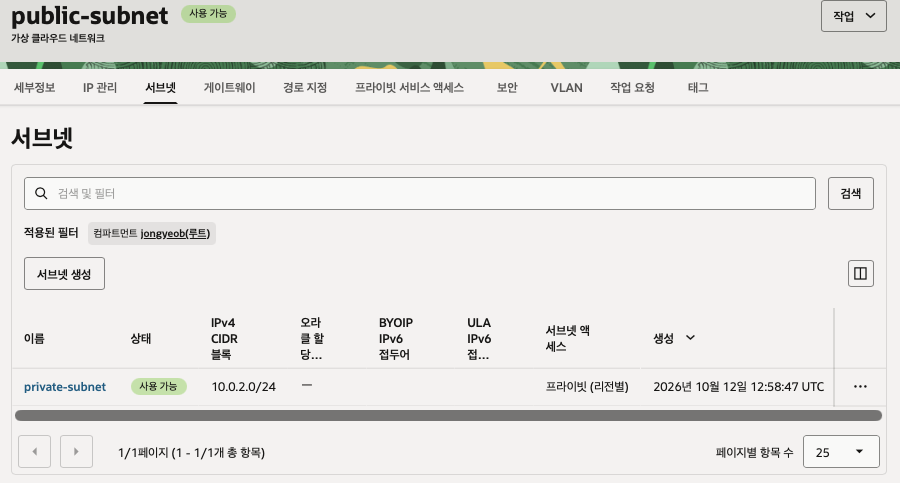
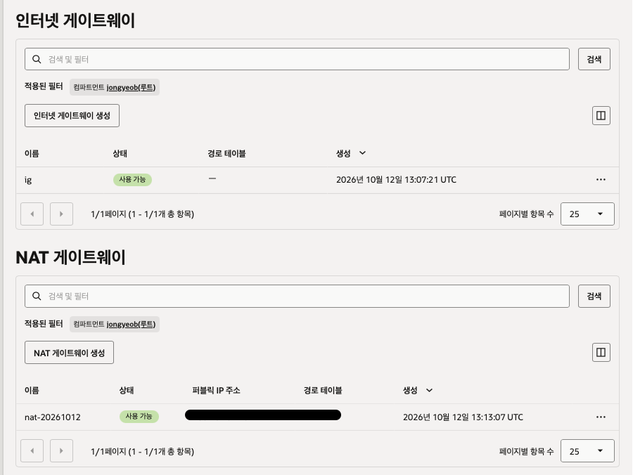
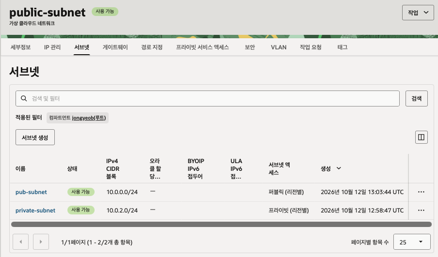
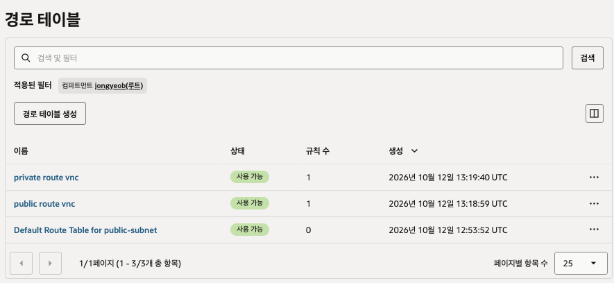

# 네트워크 설정

- 목표: vnc 구성
    - 서브넷, 게이트웨이, 라우팅 테이블 설정

## 퍼블릿 서브넷 생성

- `Networking`-`Virtual cloud networks`
    - `Create VCN`
    - `name`과 `cidr`(10.0.0.0/16)을 넣고 생성

## 프라이빗 서브넷 생성

- 만든 퍼블릭 서브넷의 `서브넷` 탭
- `Create Subnet` 클릭
    - `name`, `cidr` 블록(10.0.2.0/24) 입력
    - `Subnet Access` - `Private Subnet` 클릭
    - `Security Lists` - `Default ~~` 클릭
    - Create Subnet 클릭

## 퍼블릭 서브넷 생성

- 프라이빗 서브넷과 동일
    - `cidr`(10.0.0.0/24)
    - `Subnet Access` - `Public Subnet`

## 게이트웨이 및 Nat 게이트웨이 설정

- `Internet Gateway`가 없다면 생성
    - `Gateways` - `Create Internet Gateway`
- `NAT Gateway` 생성
    - `Gateways` - `Create Nat Gateway`
    - 임시 IP 주소 선택

## 라우팅 테이블 생성

- public route table 생성
    - `Routing` - `Create Route Table` 클릭
    - `Another Route Rule` 클릭
    - `Name` 입력
    - `Target Type` - `Internet Gateway`
    - `Destination CIDR Block` - 0.0.0.0/0
    - `Target Internet Gateway` - 생성한 IG 선택
- private route table 생성
    - `Routing` - `Create Route Table` 클릭
    - `Another Route Rule` 클릭
    - `Name` 입력
    - `Target Type` - `Nat Gateway`
    - `Destination CIDR Block` - 0.0.0.0/0
    - `Target Internet Gateway` - 생성한 NAT 선택

