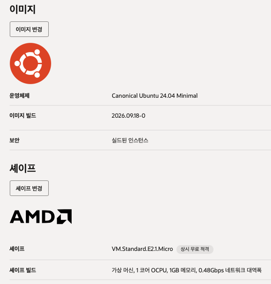
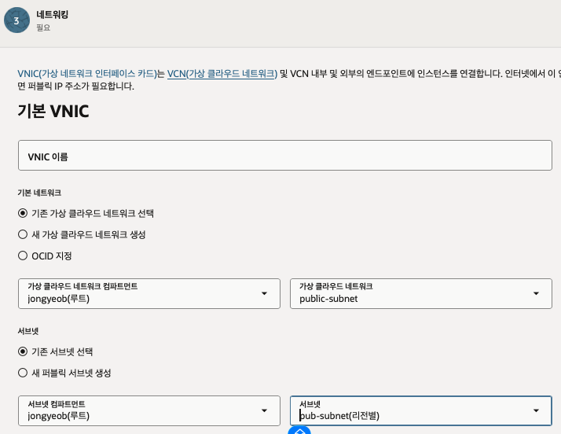
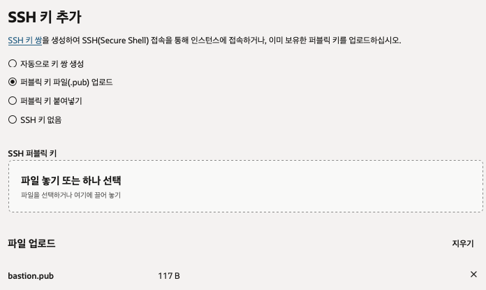
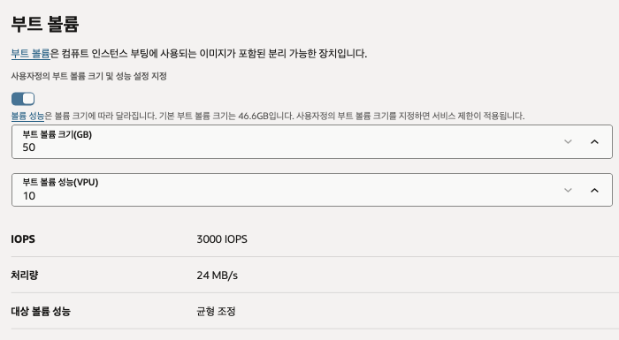
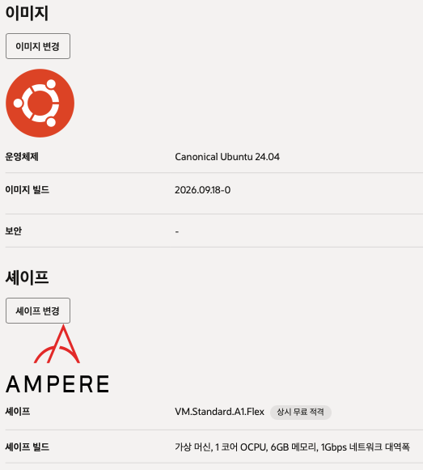

# 서버 구조 설계

- `Bastion`: Master 노드 작업을 위한 SSH 터너링 인스턴스
- `Edge proxy`: Worker의 트래픽을 받는 곳
- `Master`: 쿠버네티스 관리용 마스터 노드
- `Worker`: 쿠버네티스 워커 노드



---

# Bastion 및 Edge proxy 인스턴스 생성

- `Instance` - `Create Instance` 생성
- 이미지 - `Ubuntu 24.04 minimal`
- 셰이프 - `VM.Standard.E2.1.Micro`

  

- 네트워크 설정
    - 기본 네트워크 - `기존 가상 클라우드 네트워크 선택`
        - 가상 클라우드 네트워크 - `만들어 놓은 VNIC` 선택
    - 서브넷 - `기존 서브넷 선택`
        - 서브넷 - `퍼블릭 서브넷` 선택
- SSH 키 생성 및 적용
    - `ssh-keygen -f ~/.ssh/bastion` 로 키 생성
    - `bastion.pub` 파일 업로드

      

- 스토리지 생성
    - **사용자정의 부트 볼륨 크기 및 성능 설정 지정**
    - 용량 - 50GB

  


---

# 쿠버네티스 마스터 - 워커 인스턴스 생성

- bastion과 edge-proxy 만들때와 동일
    - image - `Ubuntu 24.04`
    - 셰이프 - `VM.Standard.A1.Flex`
    - 네트워크 설정
        - 서브넷 - `프라이빗 서브넷` 선택



---

# 최종 결과



---

# SSH-Tunneling 설정

- `~/.ssh/config` 파일 설정

    ```yaml
    Host oci-bastion
      HostName 공인IP
      User ubuntu
      IdentitiesOnly yes
      IdentityFile ~/.ssh/bastion
    
    Host edge-proxy
      HostName 내부IP
      ProxyJump oci-bastion
      User ubuntu
      IdentitiesOnly yes
      IdentityFile ~/.ssh/edge-proxy
    
    Host master
      HostName 내부IP
      ProxyJump oci-bastion
      User ubuntu
      IdentitiesOnly yes
      IdentityFile ~/.ssh/master
    
    Host worker
      HostName 내부IP
      ProxyJump oci-bastion
      User ubuntu
      IdentitiesOnly yes
      IdentityFile ~/.ssh/worker
    ```

- SSH 접속 테스트
    - `ssh oci-bastion`, `ssh master` 등을 터미널에 입력하여 접속 확인