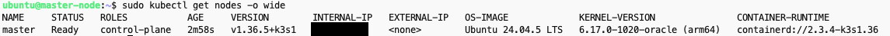
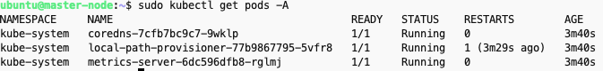
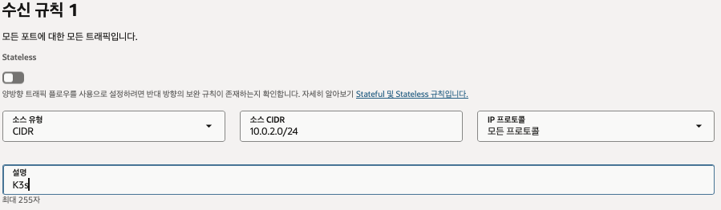
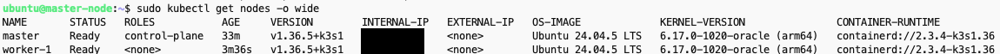

# Master 쿠버네티스 설치

1. ssh 연결
2. 명령어 입력

```bash
curl -sfL https://get.k3s.io | INSTALL_K3S_EXEC="server \
--node-ip {master-node-private-ip} \
--advertise-address {master-node-private-ip} \
--flannel-iface enp0s6 \
--flannel-backend=vxlan \
--write-kubeconfig-mode=644 \
--disable=traefik \
--node-name master" sh -
```

1. 설치 확인
    - `sudo kubectl get nodes -o wide` - 노드가 클러스터에 정상 등록 됐는 지 확인

      

    - `sudo kubectl get pods -A` - 클러스터 기본 구성 요소가 떴는 지 확인

      

2. Worker 조인용 토큰 확인 및 백업
    - `sudo cat /var/lib/rancher/k3s/server/node-token`

---

# Worker Agent 설치 및 연결

1. private 서브넷의 보안 리스트에 K3s 포트(6443)를 수신 규칙에 추가

   

2. 연결 확인 - `curl -k https://{master-node-private-ip}:6443`

    <aside>
    💡

   Couldn't connect to server가 발생한다면?

   Master에서 `sudo iptables -L INPUT -n --line-numbers` 명령어로 iptables를 검사하고 `target=REJECT`가 있으면 삭제해줘야한다.

    1. 지금 적용된 규칙에서 삭제 (INPUT, FORWARD 둘 다)
        - sudo iptables -D INPUT -j REJECT --reject-with icmp-host-prohibited
        - sudo iptables -D FORWARD -j REJECT --reject-with icmp-host-prohibited

    2. 재부팅해도 다시 생기지 않도록 저장 파일에서도 삭제
        - sudo cp /etc/iptables/rules.v4 ~/rules.v4.bak
        - sudo sed -i '/icmp-host-prohibited/d' /etc/iptables/rules.v4

    </aside>

3. k3s 에이전트 설치

    ```bash
    curl -sfL https://get.k3s.io | INSTALL_K3S_EXEC="agent \
      --server https://{master-node-private-ip}:6443 \
      --token {토큰} \
      --node-ip {worker-node-private-ip} \
      --flannel-iface enp0s6 \
      --node-name worker-1" sh -
    ```

4. k3s 에이전트 정상 동작 여부 확인 - `sudo systemctl status k3s-agent`

    ```bash
    ● k3s-agent.service - Lightweight Kubernetes
         Loaded: loaded (/etc/systemd/system/k3s-agent.service; enabled; preset: enabled)
         Active: active (running) since Wed 2026-10-14 13:31:30 UTC; 3s ago
           Docs: https://k3s.io
        Process: 27407 ExecStartPre=/sbin/modprobe br_netfilter (code=exited, status=0/SUCCESS)
        Process: 27409 ExecStartPre=/sbin/modprobe overlay (code=exited, status=0/SUCCESS)
       Main PID: 27411 (k3s-agent)
          Tasks: 18
         Memory: 57.5M (peak: 59.1M)
            CPU: 769ms
         CGroup: /system.slice/k3s-agent.service
                 ├─27411 "/usr/local/bin/k3s agent"
                 └─27425 "containerd "
    
    Oct 14 13:31:29 worker k3s[27411]: I1014 13:31:29.672496   27411 kuberuntime_manager.go:2172] "Updating runtime config through cri with podcidr" CIDR="10.42.1.0/24"
    Oct 14 13:31:29 worker k3s[27411]: I1014 13:31:29.673539   27411 kubelet_network.go:48] "Updating Pod CIDR" originalPodCIDR="" newPodCIDR="10.42.1.0/24"
    Oct 14 13:31:29 worker k3s[27411]: time="2026-10-14T13:31:29Z" level=info msg="Tunnel authorizer set Kubelet Port 0.0.0.0:10250"
    Oct 14 13:31:30 worker k3s[27411]: I1014 13:31:30.425099   27411 apiserver.go:51] "Watching apiserver"
    Oct 14 13:31:30 worker k3s[27411]: time="2026-10-14T13:31:30Z" level=info msg="Starting network policy controller version v2.6.3-k3s1, built on 2026-09-30T16:04:19Z, go1.26.8"
    Oct 14 13:31:30 worker k3s[27411]: time="2026-10-14T13:31:30Z" level=info msg="k3s agent is up and running"
    Oct 14 13:31:30 worker systemd[1]: Started k3s-agent.service - Lightweight Kubernetes.
    Oct 14 13:31:30 worker k3s[27411]: I1014 13:31:30.433016   27411 network_policy_controller.go:164] Starting network policy controller
    Oct 14 13:31:30 worker k3s[27411]: I1014 13:31:30.473279   27411 network_policy_controller.go:179] Starting network policy controller full sync goroutine
    Oct 14 13:31:30 worker k3s[27411]: I1014 13:31:30.477683   27411 desired_state_of_world_populator.go:154] "Finished populating initial desired state of world"
    ```

5. master 노드에 워커가 잡혔는 지 확인 - `sudo kubectl get nodes -o wide`

   