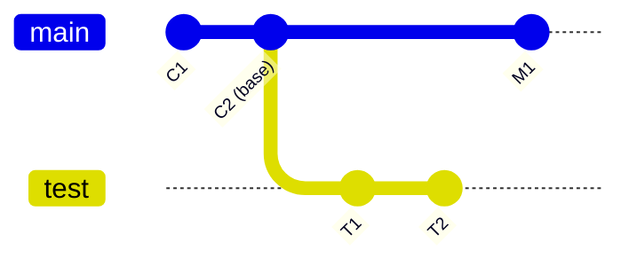
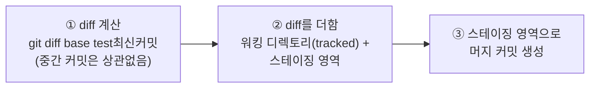
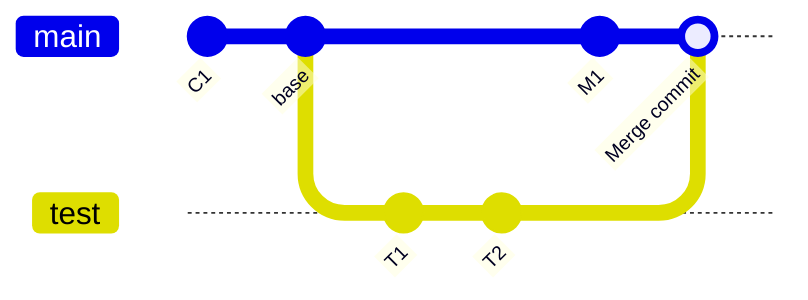
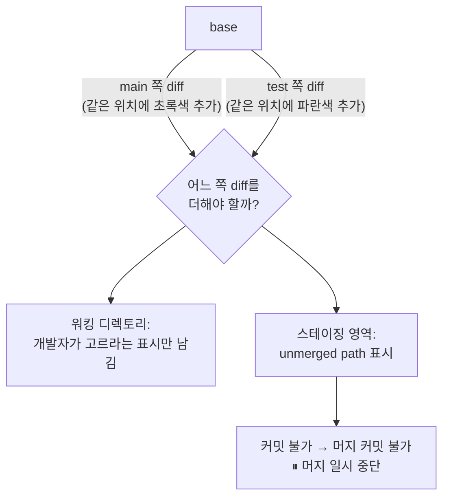
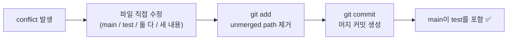
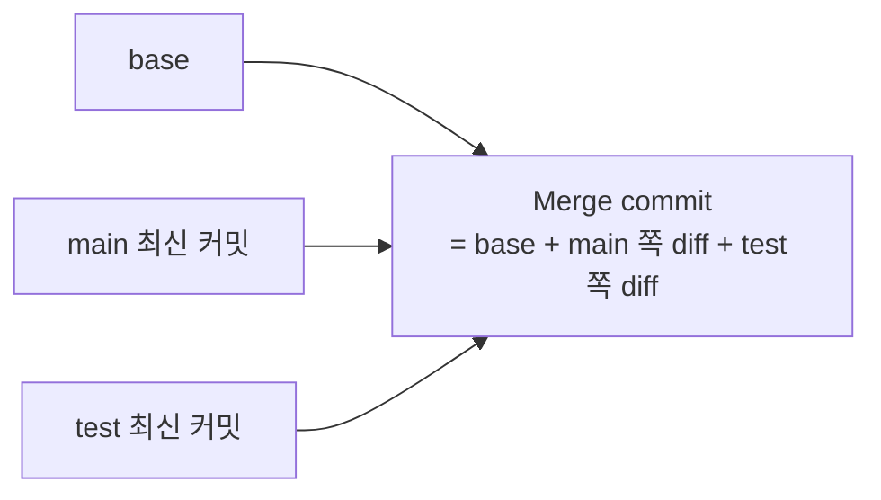
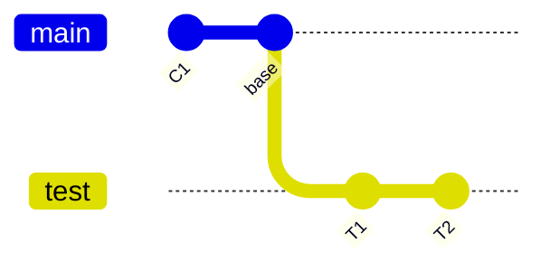
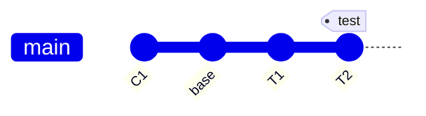

# 병합(Merge)란?

- 브랜치를 만드는 이유는 **다른 브랜치에서 독립적으로 개발하고, 그 결과를 원본 브랜치로 쉽게 가져오기 위해서**다.
- 이때 다른 브랜치의 작업 내용을 원본 브랜치로 가져오는 것을 **머지**라고 한다.

## 용어 정리

| 용어 | 의미 |
| --- | --- |
| 커밋 히스토리 | 커밋들을 선으로 쭉 이은 그림 |
| 베이스(base) | 두 브랜치가 갈라지는 지점의 커밋 |



# 커밋 히스토리 모양에 따라 머지 방식

베이스를 기준으로 `main`과 `test` 각각에 커밋이 **있거나 없거나** → 2가지 경우가 생긴다.

| main (base 이후) | test (base 이후) | 머지 방식 |
| --- | --- | --- |
| 커밋 있음 | 커밋 있음 | **3-way merge** |
| 커밋 없음 | 커밋 있음 | **fast-forward merge** |

# 3-way merge 동작 원리

```bash
git merge test   # HEAD가 가리키는 브랜치(main)가 test를 머지한다.
```

`git merge <브랜치>`는 **현재 체크아웃한 브랜치(HEAD가 가리키는 브랜치)가 지정한 브랜치를 머지**한다는 뜻이다.



1. **diff 계산**: base와 test 최신 커밋 **두 커밋 사이의 차이**만 구한다. 중간에 어떤 커밋이 있었는지는 중요하지 않다.
2. **diff 적용**: 구한 diff를 워킹 디렉토리(tracked 상태)와 스테이징 영역에 더한다.
3. **커밋 생성**: 스테이징 영역의 내용으로 커밋을 만든다. → **머지 커밋(Merge Commit)**

## 머지 결과



- 머지 커밋은 **부모가 2개**다. main 최신 커밋과 test 최신 커밋을 모두 가리킨다.
- 브랜치의 범위 = 최신 커밋에서 화살표로 연쇄적으로 이어지는 마지막 커밋까지
- 머지 커밋이 main의 최신 커밋이 되므로 **main이 test의 커밋들을 쏙 포함**하게 된다.

## Conflict(충돌)

- 두 브랜치에서 **같은 파일의 같은 위치**를 서로 다르게 수정한 뒤 머지하면 conflict가 발생한다.



- 한쪽 diff를 더하면 다른 쪽 diff가 무시되는 상황이라, Git은 **어느 diff도 적용하지 않는다**.
- 워킹 디렉토리 파일에는 **선택하라는 표시**만 남긴다.
- 스테이징 영역의 파일에는 **unmerged path**가 붙는다.
- unmerged path가 있으면 커밋을 만들 수 없다.
  → 머지 커밋도 못 만든다.
  → **머지가 중간에 멈춘다**.

충돌 표시 예시:

```
<<<<<<< HEAD
main 브랜치 쪽 내용
=======
test 브랜치 쪽 내용
>>>>>>> test
```

## Conflict 해결 방법

```bash
git status          # unmerged path가 붙은 파일 확인
vi Rectangle        # 충돌 표시를 보고 내용을 직접 정리
git add Rectangle   # 스테이징 → unmerged path 사라짐
git commit          # 머지 커밋 생성 (기본 메시지 사용 가능)
```



충돌 부분은 main 쪽, test 쪽, 양쪽 모두를 선택해도 되고, 아예 다른 내용으로 바꿔도 된다.

## **3-way merge라 하는 이유**



- 머지 커밋은 **base + main 쪽 diff + test 쪽 diff**로 만들어진다.
- 즉 **base, main 최신 커밋, test 최신 커밋, 이 3개의 커밋이 머지 커밋 하나를 만든다.**
- 그래서 **3-way merge**라고 부른다.

---

# fast-forward 병합

- `main`이 `test`를 머지할 때, **base 이후로 test에만 커밋이 있는 경우 발생한다.**



## 머지 커밋을 만들지 않는 이유

- main 쪽에는 base 이후 커밋이 없다.
  → main 쪽 diff가 없다.
  → 머지 커밋을 만들어도 **base + test 쪽 diff = test 최신 커밋과 똑같은 내용**이다.
- 똑같은 커밋을 하나 더 만들 필요가 없다.

## 동작 원리

- 머지 커밋 없이 **main의 범위를 test와 똑같이 늘린다**.
- test 최신 커밋이 곧 main의 최신 커밋이 된다.
- main을 앞으로 **빨리 감기** 한 모양이라 fast-forward라고 부른다.



## 3-way merge와 다른 점

- diff를 더하는 과정이 없다.
  → **conflict가 절대 발생하지 않는다**.
- 머지 커밋이 없어서 커밋 히스토리가 **선형**이라 단순하다.