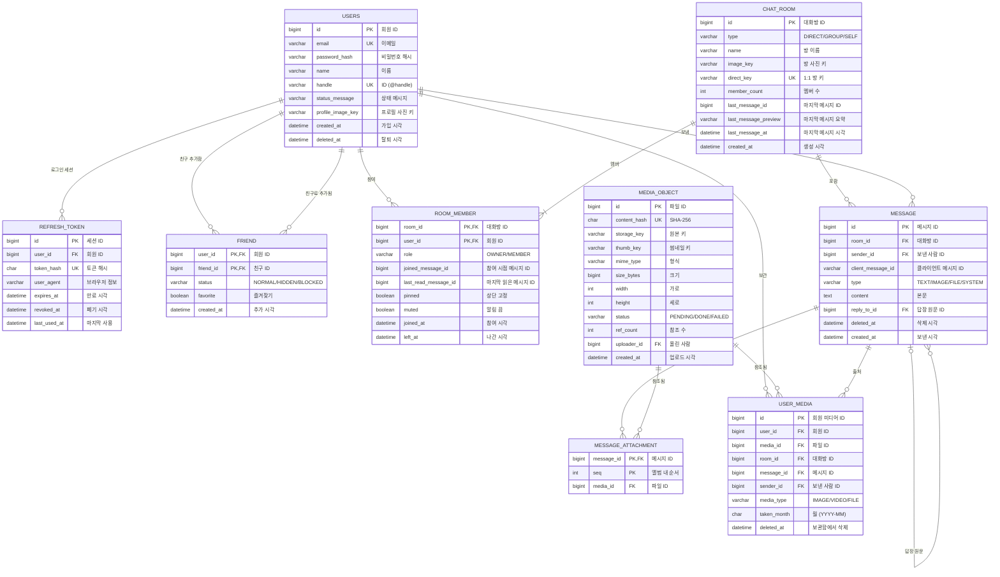

# Side -  Rest API 명세서 정의 및 논리설계
# 채팅 웹 REST API 명세서

현재 프런트(chat-web)가 호출하는 REST API 6개를 정리한 문서입니다.

## 목차

| API | 메서드 | URL |
|---|---|---|
| [로그인](#로그인) | POST | `/api/auth/login` |
| [토큰 재발급](#토큰-재발급) | POST | `/api/auth/refresh` |
| [로그아웃](#로그아웃) | POST | `/api/auth/logout` |
| [대화방 목록 조회](#대화방-목록-조회) | GET | `/api/rooms` |
| [대화방 조회](#대화방-조회) | GET | `/api/rooms/{roomId}` |
| [메시지 목록 조회](#메시지-목록-조회) | GET | `/api/rooms/{roomId}/messages` |
| [공통 에러 코드](#공통-에러-코드) | | |

## 공통 규칙

| 항목 | 규칙 |
|---|---|
| Content-Type | `application/json`, UTF-8 |
| ID | 모든 ID는 String (TSID는 JS 숫자 정밀도를 넘음) |
| 날짜 | ISO 8601, 시간대 포함 (예: `2026-11-05T14:01:00+09:00`) |
| 인증 | `Authorization: Bearer {ACCESS_TOKEN}`, Refresh 토큰은 HttpOnly 쿠키 |
| 401 | 토큰 만료·없음일 때만 사용 (프런트가 재발급 후 재시도) |
| 403 | 로그인은 됐지만 권한 없음 |

---

## 로그인

이메일과 비밀번호로 로그인하고 토큰을 발급합니다.

### 기본 정보

| 메서드 | URL | 인증 방식 |
|---|---|---|
| POST | `/api/auth/login` | 없음 |

#### 주요 에러 코드

| HTTP | 코드 | 설명 |
|---|---|---|
| 400 | `INVALID_REQUEST` | 이메일·비밀번호가 비었거나 이메일 형식이 아님 |
| 401 | `LOGIN_FAILED` | 이메일 또는 비밀번호 불일치 |
| 429 | `LOGIN_LOCKED` | 5회 연속 실패로 일시 잠금 (2단계) |

### 요청

#### 요청 헤더

| 이름 | 설명 | 필수 |
|---|---|---|
| Content-Type | `application/json` | O |

#### 본문

| 이름 | 타입 | 설명 | 필수 |
|---|---|---|---|
| email | String | 이메일 | O |
| password | String | 비밀번호 | O |

### 응답

#### 응답 헤더

| 이름 | 설명 |
|---|---|
| Set-Cookie | `refresh_token={REFRESH_TOKEN}; HttpOnly; Secure; SameSite=Lax; Path=/api/auth` |

#### 응답 본문

| 이름 | 타입 | 설명 | 필수 |
|---|---|---|---|
| accessToken | String | Access 토큰 (JWT) | O |

### 예제

#### 예제 요청

```bash
curl -v -X POST "/api/auth/login" \
  -H "Content-Type: application/json" \
  -d '{"email":"me@example.com","password":"abcd1234!"}'
```

#### 응답: 성공

```
HTTP/1.1 200 OK
Set-Cookie: refresh_token=...; HttpOnly; Secure; SameSite=Lax; Path=/api/auth
```

```json
{ "accessToken": "eyJhbGciOi..." }
```

#### 응답: 실패

```
HTTP/1.1 401 Unauthorized
```

```json
{ "code": "LOGIN_FAILED", "message": "이메일 또는 비밀번호가 맞지 않아요" }
```

---

## 토큰 재발급

Refresh 토큰 쿠키로 새 Access 토큰을 발급합니다.

### 기본 정보

| 메서드 | URL | 인증 방식 |
|---|---|---|
| POST | `/api/auth/refresh` | Refresh 토큰 쿠키 |

#### 주요 에러 코드

| HTTP | 코드 | 설명 |
|---|---|---|
| 401 | `REFRESH_TOKEN_MISSING` | Refresh 쿠키 없음 |
| 401 | `REFRESH_TOKEN_EXPIRED` | Refresh 토큰 만료 |
| 401 | `REFRESH_TOKEN_REVOKED` | 폐기된 토큰 (로그아웃, 원격 로그아웃, 재사용 감지) |

### 요청

#### 요청 헤더

| 이름 | 설명 | 필수 |
|---|---|---|
| Cookie | `refresh_token={REFRESH_TOKEN}` | O |

본문 없음

### 응답

#### 응답 본문

| 이름 | 타입 | 설명 | 필수 |
|---|---|---|---|
| accessToken | String | 새 Access 토큰 | O |

### 예제

#### 예제 요청

```bash
curl -v -X POST "/api/auth/refresh" \
  -b "refresh_token=${REFRESH_TOKEN}"
```

#### 응답: 성공

```
HTTP/1.1 200 OK
```

```json
{ "accessToken": "eyJhbGciOi..." }
```

#### 응답: 실패

```
HTTP/1.1 401 Unauthorized
```

```json
{ "code": "REFRESH_TOKEN_EXPIRED", "message": "다시 로그인해 주세요" }
```

---

## 로그아웃

Refresh 토큰을 폐기하고 쿠키를 삭제합니다.

### 기본 정보

| 메서드 | URL | 인증 방식 |
|---|---|---|
| POST | `/api/auth/logout` | Access 토큰 + Refresh 토큰 쿠키 |

#### 주요 에러 코드

| HTTP | 코드 | 설명 |
|---|---|---|
| 401 | `TOKEN_MISSING` · `TOKEN_EXPIRED` · `TOKEN_INVALID` | 공통 인증 오류 |

### 요청

#### 요청 헤더

| 이름 | 설명 | 필수 |
|---|---|---|
| Authorization | `Bearer {ACCESS_TOKEN}` | O |
| Cookie | `refresh_token={REFRESH_TOKEN}` | O |

본문 없음

### 응답

#### 응답 헤더

| 이름 | 설명 |
|---|---|
| Set-Cookie | `refresh_token=; Max-Age=0; Path=/api/auth` (쿠키 삭제) |

본문 없음

### 예제

#### 예제 요청

```bash
curl -v -X POST "/api/auth/logout" \
  -H "Authorization: Bearer ${ACCESS_TOKEN}" \
  -b "refresh_token=${REFRESH_TOKEN}"
```

#### 응답: 성공

```
HTTP/1.1 204 No Content
Set-Cookie: refresh_token=; Max-Age=0; Path=/api/auth
```

---

## 대화방 목록 조회

내가 멤버로 있는 대화방 목록을 조회합니다.

### 기본 정보

| 메서드 | URL | 인증 방식 |
|---|---|---|
| GET | `/api/rooms` | Access 토큰 |

#### 주요 에러 코드

| HTTP | 코드 | 설명 |
|---|---|---|
| 401 | `TOKEN_MISSING` · `TOKEN_EXPIRED` · `TOKEN_INVALID` | 공통 인증 오류 |

### 요청

#### 요청 헤더

| 이름 | 설명 | 필수 |
|---|---|---|
| Authorization | `Bearer {ACCESS_TOKEN}` | O |

### 응답

#### 응답 본문

| 이름 | 타입 | 설명 | 필수 |
|---|---|---|---|
| (배열) | RoomSummary[] | 대화방 목록. 상단 고정 방 먼저, 그다음 마지막 메시지 최신순. 방이 없으면 빈 배열 | O |

#### RoomSummary

| 이름 | 타입 | 설명 | 필수 |
|---|---|---|---|
| id | String | 대화방 ID | O |
| type | Enum | `DIRECT`(1:1), `GROUP`(그룹), `SELF`(나와의 채팅), `OPEN`(오픈채팅) | O |
| name | String | 대화방 이름. 1:1은 상대방 이름 | O |
| imageUrl | String | 대화방 사진 URL (제공 조건: 사진이 있을 때) | X |
| memberCount | Integer | 멤버 수 | O |
| lastMessagePreview | String | 마지막 메시지 요약 (제공 조건: 메시지가 있을 때) | X |
| lastMessageAt | Datetime | 마지막 메시지 시각, ISO 8601 (제공 조건: 메시지가 있을 때) | X |
| unreadCount | Integer | 내가 안 읽은 메시지 수 | O |
| pinned | Boolean | 목록 상단 고정 여부 | O |

### 예제

#### 예제 요청

```bash
curl -v -G "/api/rooms" \
  -H "Authorization: Bearer ${ACCESS_TOKEN}"
```

#### 응답: 성공

```
HTTP/1.1 200 OK
```

```json
[
  {
    "id": "0K2Q8M3T5V7XA",
    "type": "GROUP",
    "name": "스프링 스터디",
    "imageUrl": null,
    "memberCount": 4,
    "lastMessagePreview": "도윤: 오 최고!",
    "lastMessageAt": "2026-11-05T14:06:00+09:00",
    "unreadCount": 3,
    "pinned": false
  }
]
```

---

## 대화방 조회

대화방 하나의 정보를 조회합니다.

### 기본 정보

| 메서드 | URL | 인증 방식 |
|---|---|---|
| GET | `/api/rooms/{roomId}` | Access 토큰 |

#### 주요 에러 코드

| HTTP | 코드 | 설명 |
|---|---|---|
| 401 | `TOKEN_MISSING` · `TOKEN_EXPIRED` · `TOKEN_INVALID` | 공통 인증 오류 |
| 403 | `ROOM_FORBIDDEN` | 대화방 멤버가 아님 |
| 404 | `ROOM_NOT_FOUND` | 없는 대화방 |

### 요청

#### 요청 헤더

| 이름 | 설명 | 필수 |
|---|---|---|
| Authorization | `Bearer {ACCESS_TOKEN}` | O |

#### 경로 파라미터

| 이름 | 타입 | 설명 | 필수 |
|---|---|---|---|
| roomId | String | 대화방 ID | O |

### 응답

#### 응답 본문

[RoomSummary](#roomsummary) (대화방 목록 조회와 같은 형식)

### 예제

#### 예제 요청

```bash
curl -v -G "/api/rooms/0K2Q8M3T5V7XA" \
  -H "Authorization: Bearer ${ACCESS_TOKEN}"
```

#### 응답: 성공

```
HTTP/1.1 200 OK
```

```json
{
  "id": "0K2Q8M3T5V7XA",
  "type": "GROUP",
  "name": "스프링 스터디",
  "imageUrl": null,
  "memberCount": 4,
  "lastMessagePreview": "도윤: 오 최고!",
  "lastMessageAt": "2026-11-05T14:06:00+09:00",
  "unreadCount": 3,
  "pinned": false
}
```

#### 응답: 실패

```
HTTP/1.1 403 Forbidden
```

```json
{ "code": "ROOM_FORBIDDEN", "message": "이 대화방의 멤버가 아니에요" }
```

---

## 메시지 목록 조회

대화방의 메시지를 커서 방식으로 조회합니다. 최신 메시지부터 내려줍니다.

### 기본 정보

| 메서드 | URL | 인증 방식 |
|---|---|---|
| GET | `/api/rooms/{roomId}/messages` | Access 토큰 |

#### 주요 에러 코드

| HTTP | 코드 | 설명 |
|---|---|---|
| 400 | `INVALID_SIZE` | `size`가 1~100 범위 밖 |
| 400 | `INVALID_CURSOR` | `cursor` 형식 오류 |
| 401 | `TOKEN_MISSING` · `TOKEN_EXPIRED` · `TOKEN_INVALID` | 공통 인증 오류 |
| 403 | `ROOM_FORBIDDEN` | 대화방 멤버가 아님 |
| 404 | `ROOM_NOT_FOUND` | 없는 대화방 |

### 요청

#### 요청 헤더

| 이름 | 설명 | 필수 |
|---|---|---|
| Authorization | `Bearer {ACCESS_TOKEN}` | O |

#### 경로 파라미터

| 이름 | 타입 | 설명 | 필수 |
|---|---|---|---|
| roomId | String | 대화방 ID | O |

#### 쿼리 파라미터

| 이름 | 타입 | 설명 | 필수 |
|---|---|---|---|
| size | Integer | 가져올 개수, 1~100, 기본값 50 | X |
| cursor | String | 이 ID보다 오래된 메시지부터 조회. 없으면 최신부터 | X |

### 응답

#### 응답 본문

| 이름 | 타입 | 설명 | 필수 |
|---|---|---|---|
| items | Message[] | 메시지 목록, 최신순 | O |
| nextCursor | String | 다음 요청에 넣을 `cursor` (제공 조건: `hasNext`가 true일 때) | X |
| hasNext | Boolean | 더 오래된 메시지가 있는지 | O |

#### Message

| 이름 | 타입 | 설명 | 필수 |
|---|---|---|---|
| id | String | 메시지 ID (TSID, 시간순 정렬) | O |
| clientMessageId | String | 보낼 때 클라이언트가 만든 UUID (제공 조건: 사용자가 보낸 메시지) | X |
| roomId | String | 대화방 ID | O |
| senderId | String | 보낸 사람 ID | O |
| senderName | String | 보낸 사람 이름 | O |
| type | Enum | `TEXT`, `IMAGE`, `FILE`, `SYSTEM` | O |
| content | String | 본문. 삭제된 메시지는 빈 문자열 | O |
| replyTo | ReplyTo | 답장한 원문 정보 (제공 조건: 답장 메시지일 때) | X |
| deleted | Boolean | 모든 사람에게서 삭제됐는지 | O |
| createdAt | Datetime | 보낸 시각, ISO 8601 | O |
| unreadCount | Integer | 이 메시지를 아직 안 읽은 멤버 수 | O |

#### ReplyTo

| 이름 | 타입 | 설명 | 필수 |
|---|---|---|---|
| id | String | 원문 메시지 ID | O |
| senderName | String | 원문 보낸 사람 이름 | O |
| preview | String | 원문 요약. 원문이 삭제되면 "삭제된 메시지" | O |

### 예제

#### 예제 요청

```bash
curl -v -G "/api/rooms/0K2Q8M3T5V7XA/messages" \
  -H "Authorization: Bearer ${ACCESS_TOKEN}" \
  -d "size=50" \
  -d "cursor=0K2Q8M9P1R3TB"
```

#### 응답: 성공

```
HTTP/1.1 200 OK
```

```json
{
  "items": [
    {
      "id": "0K2Q8M9P1R3TA",
      "clientMessageId": "6f1c2b9e-5a4d-4c7e-9b1a-2d3e4f5a6b7c",
      "roomId": "0K2Q8M3T5V7XA",
      "senderId": "0K2Q7A1B2C3DE",
      "senderName": "민지",
      "type": "TEXT",
      "content": "이번 주는 트랜잭션 전파 범위 정리해 오기로 했죠?",
      "replyTo": null,
      "deleted": false,
      "createdAt": "2026-11-05T14:01:00+09:00",
      "unreadCount": 2
    }
  ],
  "nextCursor": "0K2Q8M9P1R3TA",
  "hasNext": true
}
```

#### 응답: 실패

```
HTTP/1.1 400 Bad Request
```

```json
{ "code": "INVALID_SIZE", "message": "size는 1~100 사이여야 해요" }
```

---

## 공통 에러 코드

| HTTP | 코드 | 설명 |
|---|---|---|
| 401 | `TOKEN_MISSING` | Authorization 헤더 없음 |
| 401 | `TOKEN_EXPIRED` | Access 토큰 만료 (프런트가 재발급 후 재시도) |
| 401 | `TOKEN_INVALID` | 토큰 위조·형식 오류 |
| 500 | `INTERNAL_ERROR` | 서버 내부 오류 |

### 에러 응답 본문

모든 API가 같은 형식을 사용합니다.

| 이름 | 타입 | 설명 | 필수 |
|---|---|---|---|
| code | String | 에러 코드 | O |
| message | String | 사용자에게 보여 줄 수 있는 설명 | O |

```json
{ "code": "ROOM_FORBIDDEN", "message": "이 대화방의 멤버가 아니에요" }
```

---
## 설계 원칙

| 항목 | 결정 |
|---|---|
| 식별자 | 모든 PK는 TSID(64비트, 시간순). 단, 관계 테이블은 복합 PK |
| 읽음 처리 | 메시지별 읽은 사람을 저장하지 않고, 멤버별 `마지막 읽은 메시지 ID` 하나만 저장 |
| 삭제 | 메시지·회원은 행을 지우지 않고 삭제 시각만 기록 (soft delete) |
| 중복 전송 방지 | (보낸 사람, 클라이언트 메시지 ID) 유일 |
| 1:1 방 중복 방지 | 두 회원 ID를 정렬해 만든 키를 유일하게 |
| 파일 | 실제 파일은 MinIO, DB에는 저장 키와 메타데이터만. 같은 파일(해시)은 한 번만 저장 |
| 이미지 탭 | 쓰기 시 펼치기: 사진이 오가면 방 멤버마다 `회원 미디어` 행을 만들어 둠 |

## ERD



## 엔터티 목록

| 논리명 | 물리명 | 설명 | 주요 화면 |
|---|---|---|---|
| 회원 | `users` | 가입한 사용자 | 로그인, 회원가입, 프로필 |
| 로그인 세션 | `refresh_token` | 브라우저별 Refresh 토큰 | 로그인 유지, 기기 관리 |
| 친구 | `friend` | 내가 추가한 친구 (방향 있음) | 친구 탭, 차단·숨김 |
| 대화방 | `chat_room` | 1:1, 그룹, 나와의 채팅 | 대화 목록, 대화방 |
| 대화방 멤버 | `room_member` | 회원과 대화방의 참여 관계 + 읽음 위치 | 읽음 숫자, 방 설정 |
| 메시지 | `message` | 대화방에 보낸 메시지 | 대화방, 답장, 삭제 |
| 메시지 첨부 | `message_attachment` | 메시지와 파일 연결 (앨범은 여러 행) | 사진·파일 메시지 |
| 파일 | `media_object` | MinIO에 저장된 실제 파일 정보 | 업로드, 썸네일 |
| 회원 미디어 | `user_media` | 회원별 사진·파일 색인 | 이미지 탭, 모아보기 |

## 엔터티 정의

### 회원 (`users`)

| 논리명 | 물리명 | 도메인 | NULL | 키 | 설명 |
|---|---|---|---|---|---|
| 회원 ID | id | BIGINT | N | PK | TSID |
| 이메일 | email | VARCHAR(255) | N | UK | 로그인 ID |
| 비밀번호 해시 | password_hash | VARCHAR(100) | N | | BCrypt |
| 이름 | name | VARCHAR(30) | N | | 친구에게 보이는 이름 |
| 핸들 | handle | VARCHAR(30) | N | UK | `@me_dev`, 친구 찾기용 |
| 상태 메시지 | status_message | VARCHAR(60) | Y | | |
| 프로필 사진 키 | profile_image_key | VARCHAR(255) | Y | | MinIO 객체 키 |
| 가입 시각 | created_at | DATETIME(6) | N | | |
| 탈퇴 시각 | deleted_at | DATETIME(6) | Y | | soft delete |

### 로그인 세션 (`refresh_token`)

| 논리명 | 물리명 | 도메인 | NULL | 키 | 설명 |
|---|---|---|---|---|---|
| 세션 ID | id | BIGINT | N | PK | |
| 회원 ID | user_id | BIGINT | N | FK | → users.id |
| 토큰 해시 | token_hash | CHAR(64) | N | UK | 원문 대신 SHA-256 저장 |
| 브라우저 정보 | user_agent | VARCHAR(255) | Y | | 기기 관리 화면 표시용 |
| 만료 시각 | expires_at | DATETIME(6) | N | | |
| 폐기 시각 | revoked_at | DATETIME(6) | Y | | 로그아웃·원격 로그아웃 |
| 마지막 사용 | last_used_at | DATETIME(6) | Y | | |

### 친구 (`friend`)

| 논리명 | 물리명 | 도메인 | NULL | 키 | 설명 |
|---|---|---|---|---|---|
| 회원 ID | user_id | BIGINT | N | PK, FK | 추가한 사람 |
| 친구 ID | friend_id | BIGINT | N | PK, FK | 추가된 사람 |
| 상태 | status | ENUM | N | | `NORMAL`, `HIDDEN`, `BLOCKED` |
| 즐겨찾기 | favorite | BOOLEAN | N | | 기본 false |
| 추가 시각 | created_at | DATETIME(6) | N | | |

카카오톡처럼 한쪽만 추가해도 친구가 되는 **단방향** 관계입니다. A가 B를 추가하면 (A, B) 한 행만 생깁니다.

### 대화방 (`chat_room`)

| 논리명 | 물리명 | 도메인 | NULL | 키 | 설명 |
|---|---|---|---|---|---|
| 대화방 ID | id | BIGINT | N | PK | |
| 유형 | type | ENUM | N | | `DIRECT`, `GROUP`, `SELF` |
| 방 이름 | name | VARCHAR(50) | Y | | 비면 멤버 이름으로 표시 |
| 방 사진 키 | image_key | VARCHAR(255) | Y | | |
| 1:1 방 키 | direct_key | VARCHAR(41) | Y | UK | `작은ID:큰ID`, DIRECT일 때만 |
| 멤버 수 | member_count | INT | N | | 반정규화 |
| 마지막 메시지 ID | last_message_id | BIGINT | Y | | 반정규화 (목록 N+1 방지) |
| 마지막 메시지 요약 | last_message_preview | VARCHAR(100) | Y | | 반정규화 |
| 마지막 메시지 시각 | last_message_at | DATETIME(6) | Y | | 반정규화, 목록 정렬 |
| 생성 시각 | created_at | DATETIME(6) | N | | |

### 대화방 멤버 (`room_member`)

| 논리명 | 물리명 | 도메인 | NULL | 키 | 설명 |
|---|---|---|---|---|---|
| 대화방 ID | room_id | BIGINT | N | PK, FK | → chat_room.id |
| 회원 ID | user_id | BIGINT | N | PK, FK | → users.id |
| 역할 | role | ENUM | N | | `OWNER`, `MEMBER` |
| 참여 시점 메시지 ID | joined_message_id | BIGINT | N | | 이 ID 이후 메시지만 보임 |
| 마지막 읽은 메시지 ID | last_read_message_id | BIGINT | N | | 커지는 방향으로만 갱신 |
| 상단 고정 | pinned | BOOLEAN | N | | 나에게만 적용 |
| 알림 끔 | muted | BOOLEAN | N | | |
| 참여 시각 | joined_at | DATETIME(6) | N | | |
| 나간 시각 | left_at | DATETIME(6) | Y | | 나간 멤버는 NULL 아님 |

**안 읽은 수 계산**
- 메시지별: 그 방 활성 멤버 중 `last_read_message_id < 메시지 ID`인 수
- 방 목록의 내 안 읽은 수: 그 방 메시지 중 `id > 내 last_read_message_id`인 수

### 메시지 (`message`)

| 논리명 | 물리명 | 도메인 | NULL | 키 | 설명 |
|---|---|---|---|---|---|
| 메시지 ID | id | BIGINT | N | PK | TSID, 시간순 |
| 대화방 ID | room_id | BIGINT | N | FK | → chat_room.id |
| 보낸 사람 ID | sender_id | BIGINT | N | FK | → users.id (시스템 메시지는 행위자) |
| 클라이언트 메시지 ID | client_message_id | VARCHAR(36) | Y | | UUID, 중복 전송 방지 |
| 유형 | type | ENUM | N | | `TEXT`, `IMAGE`, `FILE`, `SYSTEM` |
| 본문 | content | TEXT | N | | |
| 답장 원문 ID | reply_to_id | BIGINT | Y | FK | → message.id (자기 참조) |
| 삭제 시각 | deleted_at | DATETIME(6) | Y | | 모두에게서 삭제 |
| 보낸 시각 | created_at | DATETIME(6) | N | | |

### 메시지 첨부 (`message_attachment`)

| 논리명 | 물리명 | 도메인 | NULL | 키 | 설명 |
|---|---|---|---|---|---|
| 메시지 ID | message_id | BIGINT | N | PK, FK | → message.id |
| 순서 | seq | INT | N | PK | 앨범 안 순서 (0부터) |
| 파일 ID | media_id | BIGINT | N | FK | → media_object.id |

### 파일 (`media_object`)

| 논리명 | 물리명 | 도메인 | NULL | 키 | 설명 |
|---|---|---|---|---|---|
| 파일 ID | id | BIGINT | N | PK | |
| 내용 해시 | content_hash | CHAR(64) | N | UK | SHA-256, 중복 제거 |
| 원본 키 | storage_key | VARCHAR(255) | N | | `orig/{hash}` |
| 썸네일 키 | thumb_key | VARCHAR(255) | Y | | 생성 전 NULL |
| 형식 | mime_type | VARCHAR(100) | N | | |
| 크기 | size_bytes | BIGINT | N | | |
| 가로 | width | INT | Y | | 이미지일 때 |
| 세로 | height | INT | Y | | 이미지일 때 |
| 상태 | status | ENUM | N | | `PENDING`, `DONE`, `FAILED` |
| 참조 수 | ref_count | INT | N | | 0이 되면 배치가 삭제 |
| 올린 사람 | uploader_id | BIGINT | N | FK | → users.id |
| 업로드 시각 | created_at | DATETIME(6) | N | | |

### 회원 미디어 (`user_media`)

| 논리명 | 물리명 | 도메인 | NULL | 키 | 설명 |
|---|---|---|---|---|---|
| 회원 미디어 ID | id | BIGINT | N | PK | TSID, 커서 |
| 회원 ID | user_id | BIGINT | N | FK | 이 목록의 주인 |
| 파일 ID | media_id | BIGINT | N | FK | → media_object.id |
| 대화방 ID | room_id | BIGINT | N | FK | 원래 대화로 이동용 |
| 메시지 ID | message_id | BIGINT | N | FK | 원래 대화로 이동용 |
| 보낸 사람 ID | sender_id | BIGINT | N | FK | |
| 미디어 유형 | media_type | ENUM | N | | `IMAGE`, `VIDEO`, `FILE` |
| 월 | taken_month | CHAR(7) | N | | `2026-11`, 월별 묶음 |
| 삭제 시각 | deleted_at | DATETIME(6) | Y | | 내 보관함에서만 삭제 |

## 관계

| 부모 | 자식 | 관계 | 설명 |
|---|---|---|---|
| 회원 | 로그인 세션 | 1 : N | 브라우저마다 세션 하나 |
| 회원 | 친구 | 1 : N | 내가 추가한 친구 (두 번 참조: 추가한 쪽, 추가된 쪽) |
| 회원 | 대화방 멤버 | 1 : N | |
| 대화방 | 대화방 멤버 | 1 : N (1 이상) | 멤버 없는 방은 없음 |
| 대화방 | 메시지 | 1 : N | |
| 회원 | 메시지 | 1 : N | 보낸 사람 |
| 메시지 | 메시지 | 1 : N (선택) | 답장 원문 |
| 메시지 | 메시지 첨부 | 1 : N | 앨범이면 여러 개 |
| 파일 | 메시지 첨부 | 1 : N | 같은 파일을 여러 메시지가 공유 |
| 회원 | 회원 미디어 | 1 : N | |
| 파일 | 회원 미디어 | 1 : N | |

## 유일 제약과 인덱스

| 테이블 | 종류 | 컬럼 | 용도 |
|---|---|---|---|
| users | UK | email | 로그인 |
| users | UK | handle | 친구 찾기, ID 중복 확인 |
| refresh_token | UK | token_hash | 재발급 시 조회 |
| refresh_token | IDX | user_id, revoked_at | 기기 목록 |
| friend | IDX | friend_id | 나를 추가한 사람 |
| chat_room | UK | direct_key | 1:1 방 중복 방지 |
| room_member | IDX | user_id, left_at | 내 대화방 목록 |
| message | UK | sender_id, client_message_id | 중복 전송 방지 |
| message | IDX | room_id, id DESC | 메시지 커서 페이징 |
| media_object | UK | content_hash | 같은 파일 재사용 |
| user_media | IDX | user_id, media_type, id DESC | 이미지 탭 |
